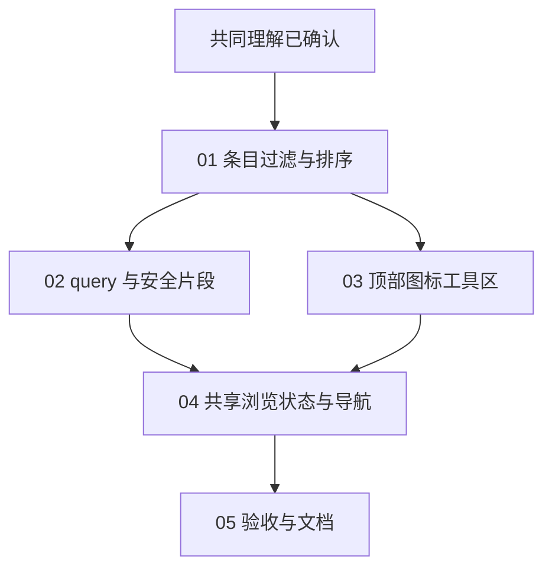

# 浏览视图控件与显示规则

Status: ready-for-agent

Product decisions: confirmed (Q1–Q27)
Final confirmation: confirmed
Design review: completed; engineering corrections applied ([review](review.md))

产品决定与完整计划已获最终共同理解确认，可按下述 Interface、实施依赖与验收要求用于后续实施。本阶段只形成计划与术语文档，未开始功能实现。

## 已确认需求

1. 主浏览界面的树、列表、网格入口改为统一风格的图标，放在一起，hover 显示含义，不再使用零散的文字按钮。
2. 每种界面都能切换是否显示隐藏文件。
3. 每种界面都有排序选项。

## 现状依据

- 现有领域决策将树模式定义为客户端外壳：左侧懒加载目录树，右侧内容区；列表与网格是目录模式里的切换，不是与树模式同层级的三个选项。参见 [ADR 0001](../../docs/adr/0001-tree-mode-client-shell.md)。
- 目录/搜索页面的列表、网格文字按钮由 `src/render.rs:168-171` 输出。
- 目录请求现有 `?sort=Column:Order` 契约，非法值返回 404；参见 `src/routes.rs:426-432`。现有排序键为 Name、Type、Size、LastModified、LastAccess、Creation，参见 `src/sort.rs:32-38`。
- 只读源代码核对确认：树 JSON 目前只有 name/href/dir/expandable，没有大小与时间字段；目录 fragment 固定使用默认排序，树端点固定目录优先、名称升序，搜索结果保持确定性 BFS 顺序与 500 条上限。参见 `src/routes.rs:508-585,739-743`、`src/listing.rs:34,99-127`。让这些界面支持用户选定的排序，需要显式更新相关契约，不只是添加按钮。
- 搜索页当前不具备树模式入口；文档直链页面可以进入树模式。参见 `assets/chapbook-browser.js:794-804`。统一控件的覆盖范围尚待确认。
- 当前隐藏与排序规则不一致或缺失，不影响路径安全、非 UTF-8 路径只显示、原始文件/下载与 PDF 原生查看器等既有安全及内容响应契约；本计划不得借显示控制修改这些边界。
- 已运行当前源码的 `cargo run -- --host 127.0.0.1 --port 38743 .`，在真实 Chromium 中切换列表、网格、树并观察界面。列表的排序入口在表头；切换网格或树后没有相同入口。三个界面均显示服务根目录中的 `.git`、`.github`、`.gitignore`、`.scratch`，没有隐藏文件开关。
- 未修改功能代码，未运行测试；本轮为设计现状核对。

## 已确认术语与设计决定

用户已明确答复四轮 Q1–Q27「全部同意」。已确认术语即时记录到 [GLOSSARY.md](../../GLOSSARY.md)。

- **Q1 — 浏览视图层级**：树、列表、网格为三个同级、互斥的浏览视图。树视图保留左侧目录树与右侧内容区；列表/网格不显示树侧栏，不引入树＋网格的组合状态。
- **Q2 — 控制范围**：隐藏与排序覆盖主浏览区、树节点、树右侧目录内容、搜索结果和目录预览中的条目展示；文档正文、原始文件与下载行为不变。
- **Q3 — 隐藏项定义**：目录条目自身名称以 `.` 开头即为隐藏项，文件与目录一致，符号链接按链接自身名字判断。`a.b` 不隐藏，`../` 是导航项；不引入权限或平台专属隐藏属性。
- **Q4 — 共享显示偏好**：三个视图共享隐藏项显示、排序键与排序方向，切换视图不重置这些选择。
- **Q5 — 顶部工具区**：三种视图共用顶部工具区，左侧搜索，右侧为树/列表/网格图标组、隐藏项开关、排序入口。树视图的切换不再藏在左侧树栏；窄屏整组换行，三个视图图标不拆散。提供 hover/键盘焦点提示、可访问名称与明确选中态。
- **Q6 — 浏览上下文**：切换视图保留当前目录、文件或查询。树中看可见文件时，列表/网格显示其父目录并选中文件，回树仍打开该文件；文档直链采用同样规则。搜索切换视图保留查询，树右侧显示搜索结果。
- **Q7 — 初始状态**：没有保存偏好时默认列表、不显示隐藏项；已有偏好时尊重用户选择。
- **Q8 — 过滤而非权限**：隐藏项开关只影响浏览与搜索，不禁止直接 URL、原始文件或下载访问；关闭显示不关闭已打开的隐藏文件。
- **Q9 — 隐藏目录分支**：根目录搜索与树遍历跳过隐藏目录及后代；按浏览路径名称判断普通名字的符号链接，服务根目录自身名称不参与隐藏判定。
- **Q10 — 排序键集合**：保留名称、类型、大小、修改时间、访问时间、创建时间六项，各项支持升序/降序。树按同级节点排序，不打平层级；字段含义已由 Q19–Q22 确认。
- **Q11 — 目录优先**：所有条目展示先目录、后文件，升序/降序只影响各组内部。
- **Q12 — 有界搜索与展示排序**：确定性 BFS 收集最多 500 条符合过滤规则的匹配后再展示排序，被过滤的条目不占名额；不是全根目录最新/最大 500 条。
- **Q13 — 同源记忆**：同浏览器、同协议/主机/端口保存浏览视图、隐藏项显示与排序选择，跨目录、刷新、下次访问延续；同地址换根目录仍沿用这些界面偏好，不要求跨设备同步。
- **Q14 — 独立阅读页**：保留完整阅读布局，不算第四种浏览视图；三个图标作为返回浏览入口，均不标为已选，隐藏/排序入口禁用并说明用途。树打开当前文档，列表/网格显示父目录并定位文档。
- **Q15 — 目录预览**：迷你列表跟随顶部共享控件，不重复工具栏，不拥有独立视图偏好。
- **Q16 — 键盘视图切换**：浏览视图内 `v` 循环列表→网格→树→列表；输入框、可编辑区域、修饰键组合不触发，其他树导航键不变。
- **Q17 — 隐藏后的焦点**：已打开内容保留。选中/焦点回退到树的最近可见祖先或首个可见节点、列表/网格的最近可见条目；空列表落到容器，不打开回退项。回退本身不改变 pathname、q 或文档 hash；隐藏控件仍按 Q24/Q26 更新 hidden 参数。再次显示恢复隐藏分支展开，不自动抢回焦点。
- **Q18 — 隐藏目录直链**：直接打开隐藏目录可查看正常子项，只按直接子项名称过滤；根目录树与全局搜索仍跳过隐藏分支，不自动开启隐藏显示。
- **Q19 — 默认与名称排序**：默认 Name:Asc、目录优先。名称按原始字节序且区分大小写，不按显示 escape，不引入自然数排序；`file10` 在 `file2` 前。
- **Q20 — 条目类型**：文件按末尾扩展名排序，列表类型列相应显示扩展名；ASCII 大小写不敏感，无扩展名独立分组、升序时在前。`.tar.gz` 按 `gz`，`.env` 无扩展名；目录不按后缀分类，不探测内容 MIME。
- **Q21 — 大小与时间**：沿用 metadata.len() 与既有时间处理。目录大小不是后代总大小，不递归计算。创建时间缺失仍回退 mtime，再到 Unix epoch；不可读条目处理不变。
- **Q22 — 确定性次级顺序**：主键同值固定名称升序，再以完整 root-relative 原始路径升序打破并列，不因主键降序而反转。
- **Q23 — 立即更新**：控件更新所有受影响的展示，无额外应用按钮；排序保留打开内容、展开状态和可见的选中条目，不回根目录或收起树，隐藏不可见目标按 Q17。
- **Q24 — 参数优先级**：没有有效历史/恢复快照的新访问按显式 URL > 保存偏好 > 默认；保留 `sort=Column:Order`，新增 `hidden=0|1`，后续导航延续有效规则。历史项与补能力重载先恢复其快照，不重新套用其他 tab 的偏好。访问显式链接不改长期偏好，用户操作控件才保存。
- **Q25 — 渐进增强**：无 JS 时列表隐藏/排序通过服务端 query 链接或表单可用，使用 URL 参数与默认值，不读 localStorage、不加 cookie；树/网格仍依赖 JS。
- **Q26 — 历史导航**：有 JS 时同一浏览位置的视图/隐藏/排序变化只更新当前历史项；实际目录、文件或搜索导航才新增历史。从文档进入父目录属于实际路径导航。前进/后退恢复历史项的上下文、布局与有效显示规则，不回写长期偏好；无 JS 沿用正常链接/表单导航。
- **Q27 — 分享链接**：URL 分享路径、q、sort、hidden 和既有文档锚点，不新增 layout。浏览视图采用接收者本地偏好，历史快照可保存布局；`view=1` 仍是文件显式渲染响应模式。

Q1 调整产品层面的视图层级，不撤销 ADR 0001 的客户端树壳、服务端不感知浏览视图与无 JS 渐进增强架构。共同理解确认已完成；实施与统一验收记录见 [05](issues/05-acceptance-and-documentation.md)。

## Module 与 Interface

### 条目规则：`src/listing.rs`、`src/sort.rs`、`src/meta.rs`

以现有 listing Module 作为共同 seam，新增小型 `ListingOptions { sort_by: SortBy, show_hidden: bool }`，默认 Name:Asc / false。目录枚举、搜索候选集与树数据使用同一过滤和原地排序 Implementation；SortBy 保留精确枚举与 query 格式。

隐藏判断和排序键借用原始名称/扩展名，不反推安全显示文本，不为每次比较分配 lowercase String。搜索在隐藏项占用 identity、入队或匹配名额之前跳过它；500 候选集收集后排序。不能让隐藏目录先抢占 identity 而屏蔽可见链接别名。

### 请求规则：`src/routes.rs`

统一从 query 得到 ListingOptions，传给完整目录、目录 fragment、树 JSON、搜索完整页及搜索 fragment。服务器不读取浏览器存储、不引入 cookie、不感知 tree/list/grid 布局。

| Interface | 新显示规则 | 保持的契约 |
| --- | --- | --- |
| `GET /{path}` 的目录完整页 | sort 与 hidden 作用于列表/网格 | 完整可信 UI、面包屑与父目录导航 |
| 目录 `?fragment=1` | 同一过滤集合与顺序 | CB HTML、nosniff、无 token，不回退原始字节 |
| `GET /__/tree[/{path}]` | 接受 sort 与 hidden，不再忽略 sort | 现有 JSON schema、路径校验、环与非 UTF-8 expandable 规则 |
| `GET /__/search?q=...` | 过滤后的 BFS 候选集，再按选项展示 | 空查询不遍历、500 上限、忙时 429 与真实 job permit |
| 搜索 `?fragment=1` | 新增安全搜索片段供树/历史导航使用 | 与完整页同一结果与截断信息，错误也只生成 CB HTML |
| 文件/原始字节/下载 | 显示过滤不成为访问限制 | 响应模式优先级、Range、下载头、PDF/媒体例外不变 |

sort 保持大小写敏感精确格式，非法值 404；hidden 只接受 0/1，非法值同样 404。先确定最终 ResponseMode，再选择参数、路径、metadata 与提取失败的错误出口；最终模式为 fragment 时错误仍是安全 HTML，不能因提前返回而绕过，也不能只凭 query 出现 fragment 键就绕过 download/raw 优先级。保留各类既有 HTTP 状态，包含非法 UTF-8 路径提取的 400。状态、静态资源与 native-open 等非条目路由不套用 listing 参数解析。

树 JSON 不为客户端复制排序而增添全套大小/时间字段。搜索 fragment 不能取完整页 head 或传播 token；渲染与 busy/error 响应沿用各自真实 HTTP 状态、Retry-After 和安全头。

### 可信 UI：`src/render.rs`、现有 CSS 资源

page_shell 与 doc_page 复用一套工具区 helper。目录/搜索传入有效显示规则，独立阅读页明确为阅读状态；不靠缺少某个 table 猜测页面类型。02 提供页面语义、文件系统位置的服务器生成编码 identity、搜索 q 与 ListingOptions，03 负责一致输出，04 消费该交接；identity 复用 `data-native-path-encoded`，不从显示标题、显示路径或 selectedIndex 重建。自包含 SVG 使用主题颜色、可访问名称、互斥选中态及 hover/focus 提示；无外部字体/CDN、无 inline handler、无固定悬浮工具栏。

表头排序快捷入口与顶部排序入口进入同一状态流程，保留 q/hidden，不建立第二份偏好。无 JS 使用可直接操作的 query 链接/表单；GET 表单必须用实际提交的字段保留其他选项，不能只把它们塞进 action 的 query。重新搜索保留 sort/hidden；条目、../、面包屑与搜索位置导航保留 sort/hidden，实际离开搜索才移除 q。JS 增强后不需要额外应用按钮。目录预览只承载内容，不复制工具区。

### 浏览状态：`assets/chapbook-browser.js`

- 一个 tree/list/grid 真源，区分显示偏好、当前显示规则、浏览上下文、选中条目和打开条目。独立阅读是另一个表面而非第四种浏览视图；首次文档直链保持 Q14 的阅读表面，历史中的树内文件则按快照恢复。
- 旧 cb-mode/cb-view 偏好一次迁移，旧 tree 优先，否则保留 grid/list；删除旧二级开关，不保留 shim。保留树展开、选中、宽度与折叠偏好。
- 显式链接与历史恢复不写长期偏好；控件只保存用户改变的字段，不能把其他临时 URL 规则误存成默认。
- 路径/查询实际导航新增历史；同位置布局/显示规则变化更新当前历史项。初始化在 URL 规范化之前消费有效 managed 历史快照；reload、popstate、pageshow/BFCache 恢复均按该项恢复，不写长期偏好，不用 `replaceState/pushState(null)` 擦掉快照。只有没有有效恢复快照的新访问才采用 Q24 的入口优先级。
- 快照保存表面（浏览或独立阅读）、浏览时的 tree/list/grid、位置/查询/hash、有效显示规则，以及打开条目的编码 identity/类型和选中条目的编码 identity；不携带 token 或文档正文。保留打开类型可避免过滤掉条目后在 reload 时根据 `.pdf` 后缀猜错目录。独立阅读没有活跃浏览视图。跨完整页目标项必须携带该快照，不能从共享树选中偏好猜目标；分享链接不携带快照，仍采用接收者偏好。
- 搜索允许树壳与安全结果片段；换视图保留 q，实际打开其他条目才离开搜索。现有目录节点展开/收起操作保持，过滤空分支的状态按下述版本规则处理。
- 有效选项纳入树缓存、空分支状态与请求代次；旧成功和旧错误都不得提交到新状态。复用既有取消与导航代次 seam，不新增自动重试。
- 排序保留内容、展开与可见选中项；隐藏按 Q17 退焦点，重新显示恢复展开但不抢焦点。正常目录的空结果只说明当前选项版本没有可见子项，不能永久叶子化或删除待恢复的展开意图；版本改变后失效并重取。服务端明确的环/非 UTF-8 不可展开状态保持。
- 恢复 native-open 覆盖有合法 token 的完整目录与完整搜索页的列表/网格。需要补能力时加载当前浏览上下文的完整可信页：搜索保持 `/__/search`、q/sort/hidden，不跳目录；目录保持目录位置。先保存目标快照，同路径 replace 后 reload，不新增历史；文件进入父目录等跨路径完整页转场只形成一个目标历史项并恢复定位。token 只来自合法完整页，不进入 fragment、快照或持久存储；树仍无 native-open。

### 异步结果与提交规则

- 分支更新结果明确区分成功、当前版本失败与过期；不能沿用成功和失败都 resolve 为 undefined 的加载 Interface。隐藏/排序控件立即更新当前规则、当前历史项和用户改变的偏好字段；各受影响的条目区域进入新版本加载状态，不把旧集合留作新规则下可操作的结果。
- 当前版本成功安装新数据。已展开分支部分刷新失败时，该分支显示 CB 安全错误状态，不能把旧条目冒充新规则结果或把失败当空目录；保留打开内容与待恢复的展开意图。其他成功分支正常展示新数据。旧版本的成功和错误均不提交，不新增自动重试。
- 请求目标与成功安装的内容分开记录。只有已成功安装且上下文、查询与相关显示规则一致才可跳过重取；目录/搜索内容键包含 ListingOptions，文档正文不依赖它，不能因隐藏/排序而重转换已经打开的文档。
- 普通 fragment 导航失败不提交目标历史/上下文，保留先前打开内容；历史恢复失败时浏览器已切换目标 URL/快照，保留该目标并显示安全错误，同时使成功安装标记失效。错误与忙占位不是可据此跳过重取的成功内容；原生完整页失败沿用浏览器导航语义及既有 HTTP 状态。

## 实施拆分与依赖

五份 issue 保留原有实施依赖及 ready-for-agent triage 标签；各自的实施结果和验收完成情况记录在其 Acceptance criteria 与 Comments 中。

- [01：条目过滤与排序](issues/01-shared-listing-policy.md)
- [02：query 与安全片段](issues/02-listing-query-and-fragments.md)
- [03：顶部图标工具区](issues/03-unified-browser-toolbar.md)
- [04：共享浏览状态与导航](issues/04-shared-browser-state-and-navigation.md)
- [05：消费者验收与文档](issues/05-acceptance-and-documentation.md)

02 与 03 使用 01 的相同 Interface 以及上述页面上下文交接；`render.rs` 的交叉改动由实施时的同一 integration owner 整合：02 负责选项/页面语义/编码位置传递和片段数据出口，03 负责统一工具区、元数据输出、页面骨架接入与样式。不能各建一套模板、路径编码来源或让共享编辑相互覆盖。实现期间不逐 ticket 运行 build/lint/tests/formatters，全部集成后由 05 一次集中检查并做真实 smoke。

## 必须迁移与删除的旧路径

- list_dir/search 的调用方与 render 输入统一传递 ListingOptions；exported Interface 变更前先获取引用清单，有 LSP 时用 references。
- 删除树忽略 sort、目录 fragment 固定默认排序、显示字符串名称排序和整表 reverse；Type 从 Directory/File 二分改成末尾扩展名。
- 删除散落的旧模式按钮、树顶栏迁移该按钮的逻辑、二级模式偏好与 obsolete 注释，不保留兼容 overload、alias 或反向同步。同步迁移 null 历史写入、仅按 paneCommittedPath 跳过加载、永久空分支叶子化及静默吞掉分支加载失败的旧路径。
- 更新旧树忽略排序等消费者契约；删除相关源码、类名、wording、迁移顺序和精确像素 incidental 测试，不重新锁定新 Implementation。
- 修改本计划直接涉及的文档与行为说明；旧发布记录保留，功能 smoke 后写入 `docs/release-notes-unreleased.md`，不顺便 bump 版本/依赖或修无关问题。

## 验收矩阵

下表给出本计划的消费者验收场景；对应命令、操作结果与可观察证据集中记录在 [05](issues/05-acceptance-and-documentation.md)。

| 场景 | 观察结果 | 证明方式 |
| --- | --- | --- |
| 列表→网格→树→列表 | 同一工具区、单一选中态，位置/隐藏/排序不重置 | 实际浏览器点击与键盘 |
| 首次访问与旧偏好 | 新默认列表/隐藏关闭；旧 tree/grid/list 一次迁移后仍有效 | 隔离存储浏览器场景 |
| 桌面、窄屏、亮/暗 | 所有控件可达，三个图标成组，焦点/hover 提示可见 | 真实 viewport 与截图 |
| 点文件、点目录、普通链接别名 | 所有条目出口一致过滤；隐藏分支不占 identity/搜索名额 | 路由与浏览器内容结果 |
| 隐藏目录与文件直链 | 正常子项可读；raw/download 不因隐藏开关被禁止 | 实际 HTTP 与浏览器 |
| 隐藏当前选中项、再次显示 | 内容/pathname/q/hash 不跳；hidden query 更新，焦点有效；恢复展开但不抢焦点 | 多级树及列表/网格交互 |
| 六键、两方向、等值和扩展名 | 目录优先、同级排序、固定次级顺序、Type 分类准确 | 确定性 fixture 的条目顺序 |
| raw 名称、特殊 Unicode、非 UTF-8 | 排序不用显示 escape；显示安全、identity 不变、不可操作行保持 | 平台 guard fixture 与实际链接 |
| 超过 500 个搜索匹配 | 只取过滤后 BFS 候选集；被过滤项不占名额，再排序非全局 Top-N | 有界结果与 truncated 行为 |
| 搜索三视图及返回历史 | 换视图 q 保留；打开其他条目后退恢复查询/布局/显示规则 | 实际搜索、导航、后退/前进 |
| URL 规则与保存偏好不同 | URL 优先；访问和历史恢复不污染偏好，只保存手动改动字段 | 存储隔离与内容变化 |
| 控件变化与真实导航 | 同位置不新增历史，实际路径/搜索导航新增，回退正确恢复 | 浏览器 history 行为 |
| 排序/隐藏改变时已展开树和预览 | 立即更新，不收起、不回根目录；过期成功/错误不回灌，打开文档不重转换 | 慢响应、快速切换与内容/状态 |
| 普通目录仅有隐藏孩子 | 隐藏后当前版本无可见孩子；显示回来恢复展开，不抢焦点 | 显示→隐藏→显示往返 |
| 两个展开分支一成一败 | 成功分支展示新数据；失败分支显示安全错误而非旧集合/空目录，保留内容与展开意图 | 分支故障注入，再释放旧版本响应 |
| reload、跨完整页历史与 BFCache | 快照先于初始化/偏好恢复；不同 tab 改偏好不覆盖历史布局，补 token 不多增历史 | 真实 reload、后退/前进及 persisted pageshow |
| 历史加载失败后再次恢复 | 保留目标 URL/快照，成功安装标记失效；同路径不误跳过后续加载 | 历史故障与恢复场景 |
| 文档直链与独立阅读页 | 无第四浏览视图选中态，返回父目录定位，回树保留文档 | 完整页及树内容区交互 |
| 无 JS | 列表隐藏/排序/目录/搜索导航真实可用，参数不丢失 | 禁用脚本的浏览器与 HTTP |
| fragment、JSON、错误与忙响应 | 正确类型/状态/安全头，片段无 token/裸字节，提取失败不绕过严格出口，download/raw 优先；permit 不提前释放 | 现有消费者回归与实际 HTTP |
| PDF、native-open、raw/download/Range | folder.pdf 不误判；PDF 原生新 tab；目录与搜索列表/网格均保留本机打开能力，四道门与字节出口不变 | 既有浏览器与路由安全回归，搜索树→列表/网格 |

## 验证与文档交付

1. 在隔离临时服务根目录上运行实际构建二进制，不使用用户目录做可变 fixture。
2. 集成后统一执行 `cargo test`、`cargo fmt --check`、`cargo clippy --all-targets`，调整既有路由和浏览器验收脚本的消费者行为。
3. 用真实 HTTP 和 Chromium 完成上表；测试通过不能代替 UI 证明。历史验证包含真实 reload 与跨完整页后退/前进；至少一个生命周期场景启用 BFCache 并观察 `pageshow.persisted=true`，不能仅使用现有禁用 BFCache 的两份脚本。永久测试只新增会抓到 plausible 消费者 bug 的边界，不测 wiring、源码、mock echo 或非空。
4. smoke 后更新 README、直接受影响的行为说明/ADR 0001 术语注解、术语和未发布变更记录。目录大小非子树总量、名称非自然排序、Type 新含义、BFS 候选集后排序与旧偏好迁移必须写清楚。
5. 清除临时服务、fixture 和 throwaway 脚本；只报告实际运行的验证与限制。

## 不改变的范围

CLI、零运行时外部依赖、文档正文/TOC/数学/Mermaid、原始文件协商、Range、响应模式优先级、路径解析与链接跟随、编码 identity/非 UTF-8 display-only、raw sandbox/PDF/媒体例外、可信 UI anti-framing、native-open 四道门、Office/search 有界 job permit 均保持。

不新增账户、跨设备偏好同步、MIME 内容探测、自然数排序、递归目录大小、全局搜索 Top-N、自动重试、遥测或无关功能修复。

## 当前确认与证据

- Q1–Q27 产品决定已确认；设计问题前沿为空。
- 完整计划与五份独立 issue 已获用户最终共同理解确认；生产实现覆盖统一图标工具区、共享隐藏/排序规则以及浏览状态与导航。
- 设计 review 的原有实现前提验证保留在 [review](review.md)，不替代新功能验收。
- 新功能的 Rust、实际 HTTP、Chromium、无 JS、生命周期与异步验证及临时资源清理记录见 [05](issues/05-acceptance-and-documentation.md)；五份 issue 分别记录交付范围。

